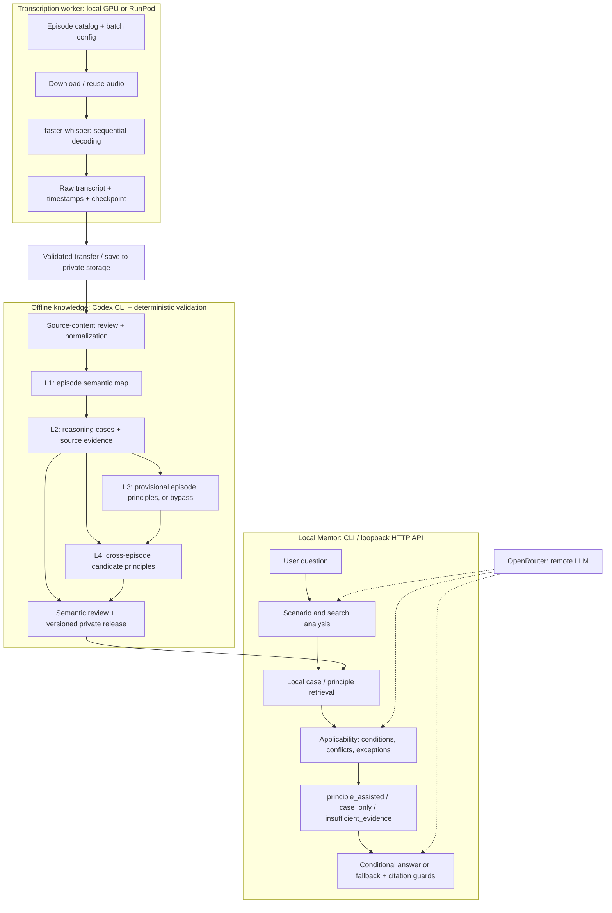

# Podcast Speaker AI Investment Mentor

Turn podcast transcripts into historical reasoning cases and a Mentor that
answers with conditions, risks and source citations.

## Usage

### Setup

Python 3.10+ on Linux/WSL:

```bash
python3 -m venv .venv
source .venv/bin/activate
python3 -m pip install -r requirements.txt
cp -n .env.example .env
```

Configure the ignored `.env`:

| Variable | Purpose |
| --- | --- |
| `PODCAST_DATA_ROOT` | Private episode metadata, audio and transcripts |
| `PIPELINE_DATA_ROOT` | Private pipeline outputs, knowledge and releases |
| `PRIVATE_DOCS_ROOT` | Private reviews and internal documents |
| `KNOWLEDGE_MODEL_ID` | Model available to the locally authenticated Codex CLI |
| `OPENROUTER_API_KEY` | Credential for online Mentor reasoning |
| `MENTOR_MODEL_ID` | Optional override of the configured Mentor model |
| `MENTOR_RELEASE` | Path to a reviewed knowledge release descriptor |

Data paths must be outside this repository. Complete artifacts stay private;
public samples are not runtime inputs. See [private data setup](docs/private_data_setup.md).

### Transcribe and Prepare

Copy a [batch config](transcription/config/batch.example.yaml) or
[GPU worker config](transcription/config/runpod.example.yaml) into private storage
and select the episodes. GPU installation, model caching and output transfer:
[RunPod guide](docs/runpod_transcription.md).

The shell variables below refer to your private configs and artifact paths;
set them before running the commands.

```bash
python3 -m transcription batch-plan --config "$BATCH_CONFIG" --dry-run
python3 -m transcription batch-run --config "$BATCH_CONFIG"
python3 -m transcription batch-status --config "$BATCH_CONFIG"
python3 -m transcription batch-resume --config "$BATCH_CONFIG"
python3 -m transcription batch-validate --config "$BATCH_CONFIG"

# Preserve raw versions before derived processing (private JSON selection).
python3 -m transcription snapshot-create --selection "$RAW_SELECTION" --root "$PRIVATE_ROOT" --output "$SNAPSHOT" --storage-config "$LOCAL_STORAGE_CONFIG" --execute
python3 -m transcription snapshot-verify --snapshot "$SNAPSHOT"
python3 -m transcription corpus-review --snapshot "$SNAPSHOT" --root "$PRIVATE_ROOT" --output "$TRIAGE_REPORT"

# After reviewing the exact transcript version:
python3 -m transcription validate-transcript --input "$RAW_TRANSCRIPT" --review "$QUALITY_REVIEW" --require-ready
python3 -m transcription prepare --input "$RAW_TRANSCRIPT" --review "$QUALITY_REVIEW" --output "$NORMALIZED_OUTPUT"
```

Completed episodes are skipped on resume. Retry failures explicitly with
`batch-resume --retry-failed`. Structural validation does not approve transcript
accuracy; [source review](transcription/README.md#quality-gate) is required before extraction.
Snapshots are checksum-bound, read-only copies, not hard links. Restore into a
new directory only; see [preservation and recovery](transcription/README.md#raw-preservation).

### Build Knowledge

Sign in to Codex CLI and create a private copy of
[the extraction config](knowledge/config/example.yaml), pointing to accepted
raw transcripts, normalized views and their reviews.

```bash
python3 -m knowledge plan --config "$KNOWLEDGE_CONFIG"
python3 -m knowledge run --config "$KNOWLEDGE_CONFIG" --through level4
python3 -m knowledge validate --config "$KNOWLEDGE_CONFIG"
# Publish only after source-grounded semantic review:
python3 -m knowledge publish --config "$KNOWLEDGE_CONFIG" --review "$KNOWLEDGE_REVIEW" --output "$MENTOR_RELEASE"
```

Only configured episodes are processed. Set `MENTOR_RELEASE` in `.env` to the
published descriptor. [Extraction, review and updates](knowledge/README.md).

### Use the Mentor

```bash
python3 -m mentor_agent --no-llm validate-data
python3 -m mentor_agent retrieve --query "When should I change a position?"
python3 -m mentor_agent ask --query "Evidence is incomplete. Should I wait or use a small position?"
python3 -m mentor_agent serve --port 8765
```

The local API exposes `/health`, `/docs` and `POST /ask` at
`http://127.0.0.1:8765`. `retrieve` makes no model calls; `ask` uses OpenRouter.
Add `--json --output "$PRIVATE_TRACE"` to an `ask --query` command to save
diagnostics privately. [Mentor configuration and API](mentor_agent/README.md).

### Tests

```bash
python3 -m pytest -q
```

Default tests use synthetic data and mocked inference; no GPU or API key is required.

## File Structure

```text
transcription/       acquisition, Whisper worker, normalization, quality gate
knowledge/           L1-L4 extraction, schemas, prompts, release validation
mentor_agent/        retrieval, applicability, answers, local HTTP API
legacy/              frozen implementations and comparison baselines
docs/                setup, architecture and artifact policies
scripts/             worker setup and output-sync helpers
config/              shared data-path examples
sample_outputs/      synthetic or reviewed public demonstration artifacts
reports/public/      curated aggregate reports
requirements.txt     local pipeline and service dependencies
requirements-runpod.txt  GPU worker dependencies
```

Active modules contain their own configs, tests and README. Complete data,
model outputs and reviews live separately in the private repository.

## System Architecture



**L2 cases are evidence; L4 principles are revisable abstractions, not extra
evidence.** Codex and OpenRouter receive selected context remotely; local
storage does not mean local LLM inference. No live-market tools or trading execution.
