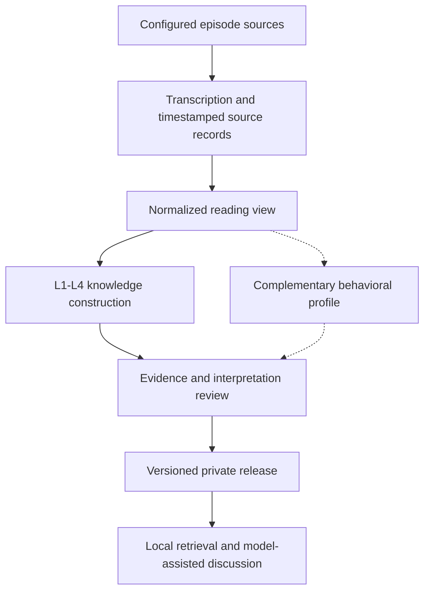

# Architecture

A reusable workflow for learning from a podcast speaker's historical discussions.
Select sources, language, models and data locations through configuration.
Source data and generated knowledge are not included in the public repository.

The dashed profile path is separate from the current knowledge release and
serving path. Implementing extraction does not automatically integrate a profile
into answering. See [knowledge layers](data-model.md),
[profile layers](speaker_profile.md) and [Mentor flow](reasoning_mentor_architecture.md).

Public code is reusable infrastructure. A particular speaker's dataset,
annotations, experiment design, tuning rationale and results belong in private
storage. Detailed project design notes are maintained privately, not in this repo.

Commands: [transcription](../transcription/README.md),
[knowledge](../knowledge/README.md), [Mentor](../mentor_agent/README.md).
