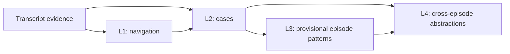

# Knowledge Layers

Raw transcripts preserve source text, segment IDs and timestamps. Normalized
views improve readability while keeping source mappings and separate annotations.

| Layer | Purpose |
| --- | --- |
| L1: Episode map | Navigate topics, resumed discussions and question/answer relationships |
| L2: Cases | Preserve claims, reasoning, actions, conditions, risks, uncertainty and source evidence |
| L3: Episode principles | Form provisional episode-local patterns where evidence supports them |
| L4: Cross-episode principles | Compare patterns across episodes, retaining exceptions, disagreement and change |

Principles are abstractions, not additional independent evidence. Generated
artifacts remain separate from accepted releases. Structural validation does
not establish semantic accuracy. Preserve previous versions when making changes.

See [knowledge usage and contracts](../knowledge/README.md) and
[private data setup](private_data_setup.md).
