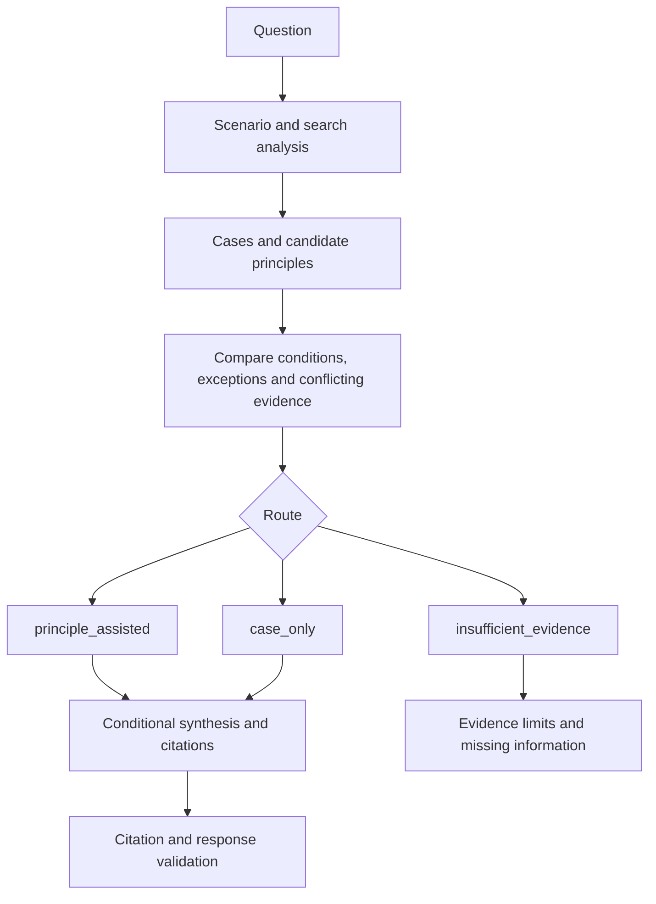

# Mentor Flow

The current runtime combines local evidence retrieval with a configured remote
model. Local files do not imply local model inference: selected context is sent
to the provider. See [runtime setup](../mentor_agent/README.md).

Principles organize reasoning; source cases support historical attribution.
Citation checks validate links, not the truth of an interpretation. The system
is for learning and discussion, not impersonation or automated trading.
Behavioral-profile extraction and integration are separate development steps.
