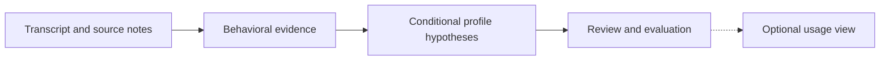

# Behavioral Profile Layers

A complementary profile describes evidence-supported decision tendencies, not
a fixed personality. It can include investment behavior, general preferences,
stated values and reported emotional responses without assuming that preferences
transfer across domains.

| Layer | Purpose |
| --- | --- |
| Behavioral evidence | Distinguish direct statements, reported actions and analyst-inferred tendencies, with source references |
| Profile hypotheses | Compare evidence across contexts and time, retaining contradictions, uncertainty and low-frequency signals |
| Optional usage view | Select relevant reviewed information for a particular use; not automatic serving integration |

Frequency, potential importance and confidence are different dimensions. A rare
observation need not be discarded, but it does not by itself prove a stable trait.
Reported actions are not independently verified behavior, and analyst commentary
is not speaker evidence. Same-source knowledge and profile items are not separate
independent observations.

Specific selections, schemas under discussion, evaluation protocols, tuning
decisions and experimental results remain private. No deployed profile integration
is claimed by this overview.

The implemented [scoped release workflow](../speaker_profile/README.md#reviewed-native-teaching-context)
supports explicit reviewed context for a personal assistant. Its `validate` and
`read` commands recheck source and review bindings without inference. They do not
approve a global persona, change source holds or enable automatic API serving.
Reading private output with a hosted assistant sends that context to its provider.
